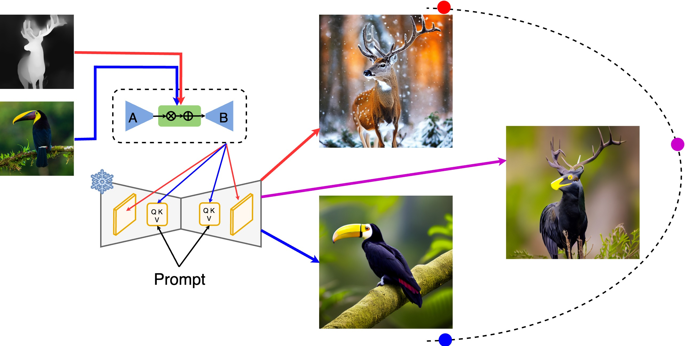

# 

<p align="center">
 <h2 align="center">Conditional LoRAdapter for Efficient 0-Shot Control & Altering of T2I Models</h2>
 <p align="center"> 
 Nick Stracke<sup>1</sup> · Stefan A. Baumann<sup>1</sup> · Josh Susskind<sup>2</sup> · Miguel A. Bautista<sup>2</sup> · Björn Ommer<sup>1</sup>
 </p>
 <p align="center"> 
    <sup>1</sup> <b>CompVis Group @ LMU Munich</b> <br/>
    <sup>2</sup> <b>Apple</b>
 </p>
</p>
<p align="center">
 <b>ECCV 2024</b>
</p>


[](https://compvis.github.io/LoRAdapter/)
[](https://arxiv.org/abs/2405.07913)

This repository contains an implementation of the paper "CTRLorALTer: Conditional LoRAdapter for Efficient 0-Shot Control & Altering of T2I Models".

We present LoRAdapter, an approach that unifies both style and structure conditioning under the same formulation using a novel conditional LoRA block that enables zero-shot control.
LoRAdapter is an efficient, powerful, and architecture-agnostic approach to condition text-to-image diffusion models, which enables fine-grained control conditioning during generation and outperforms recent state-of-the-art approaches.



---

## Segmentation-map conditioning (`segformer` branch): workflow

Generate **SDXL** images (`stable-diffusion-xl-base-1.0` + fp16-fix VAE) that follow a segmentation
layout plus a text prompt. Segmentation maps come from **SegFormer-B5** (19 Cityscapes classes;
every pixel gets a class). Images are **1280×800**, the dataset's native size.
The sister branch `grounded_sam` runs the same pipeline with Grounding DINO + SAM instead.

Run the steps **in this order**. Every command runs from the repo root with `conda activate loradapter`.
Each step's output is the next step's input.

```
 [your dataset jsonl]
        │  STEP 1  seg_map_calculations.py
        ▼
 <output_root>/{train,val,test}.jsonl   + seg maps (old segmentation)
        │  STEP 2  segformer_training.py           (uses train + val)
        ▼
 outputs/train/seg/runs/<date>/<time>/best_model
        │  STEP 3  segformer_inference.py          (uses test + the checkpoint)
        ▼
 outputs/inference_seg/runs/<date>/<time>/   generated images
        │  STEP 4  segformer_evaluate.py           (uses the SAME test jsonl + that folder)
        ▼
 <inference folder>/eval/   new segmentation + eval_pairs.jsonl + metrics.txt (mIoU, FID)
```

### Step 0: one-time setup

```
conda env create -f environment.yaml
conda activate loradapter
python download_models.py
```

`download_models.py` puts SDXL, the fp16-fix VAE, SegFormer-B5 and the prompt captioner into
`checkpoints/local_models/`. Everything runs offline (`local_files_only=true`) after that.

For FID you also need the InceptionV3 weights file once (it is not a Hugging Face model). Download
<https://github.com/toshas/torch-fidelity/releases/download/v0.2.0/weights-inception-2015-12-05-6726825d.pth>
and save it as `checkpoints/local_models/inception-2015-12-05.pth`.

### Step 1: segment the dataset (old segmentation)

`--data_dir` must contain `train.jsonl`, `val.jsonl` and `test.jsonl`, each row with
`raw_image_path` and `prompt`. Pass `--output_root` so you know exactly where the results go:
```
python seg_map_calculations.py --data_dir data/custom_dataset --width 1280 --height 800 \
    --resize_mode aspect --output_root data/custom_dataset_seg_map_aspect
```

- **Output:** `data/custom_dataset_seg_map_aspect/` holds the seg-map PNGs (`*_seg_map_aspect.png`) plus new
  `train.jsonl` / `val.jsonl` / `test.jsonl`, each row now with a `seg_path`.
- **Without `--output_root`:** results go next to the folder that holds your images (e.g. `.../images_seg_map_aspect/`).
- **Re-running:** it is safe. Maps that already exist are skipped (`--no_skip` forces a recompute).
- **Small trial run:** add `--limit_train 30 --limit_val 10`.
- **Multi-GPU:** use `seg_map_calculations_multi_GPU.py` instead.

**From here on, use only the jsonl files from this output folder**, not the original ones.

### Step 2: train

Point the config at Step 1's jsonl files, either in `configs/experiment/train_seg.yaml`
(`data.train_jsonl` / `data.val_jsonl`) or on the command line:
```
python segformer_training.py experiment=train_seg \
    data.train_jsonl=data/custom_dataset_seg_map_aspect/train.jsonl \
    data.val_jsonl=data/custom_dataset_seg_map_aspect/val.jsonl
```

- **Output:** `outputs/train/seg/runs/<date>/<time>/`:
  - `best_model/` holds the checkpoint with the lowest val loss. Use this one in Step 3.
  - `checkpoint-epochN/...` holds the per-epoch and per-`ckpt_steps` checkpoints.
- **Resume:** add `lora.struct.ckpt_path=<a checkpoint folder>`.
- **Cluster / 4 GPUs:** `experiment=train_seg_cluster`, see [CLUSTER_COMMANDS.md](CLUSTER_COMMANDS.md).

### Step 3: generate images (inference)

Use the **test** split, which training never saw:
```
python segformer_inference.py \
    ckpt_path=outputs/train/seg/runs/<date>/<time>/best_model \
    inference.json_file=data/custom_dataset_seg_map_aspect/test.jsonl
```

- **Output:** `outputs/inference_seg/runs/<date>/<time>/`. The exact path is printed on the last line
  (`Done. All results saved to: ...`); copy it for Step 4.
- **Per image:** `<name>_predicted.jpg` (the generated image), `_grid.jpg`, `_seg.jpg`, `_original.jpg`
  and `_raw_seg_gen.jpg` (an empty-prompt version, for viewing only).
- **Settings record:** `run_params.txt` lists every setting used.
- **Images only:** add `inference.save_generated_only=true` to skip the grids. Step 4 handles both layouts.
- **Step count:** keep `inference.num_inference_steps` at its default of 50 for real evaluation. A
  5-step run produces noise-like images and a near-zero mIoU.

### Step 4: segment the generated images and score them (new segmentation, mIoU, FID)

Pass the **same** jsonl you used in Step 3, plus Step 3's output folder:
```
# 4a. check that every test row has a generated image (no models loaded, a few seconds)
python segformer_evaluate.py \
    --run_dir outputs/inference_seg/runs/<date>/<time> \
    --jsonl data/custom_dataset_seg_map_aspect/test.jsonl --dry_run

# 4b. full evaluation
python segformer_evaluate.py \
    --run_dir outputs/inference_seg/runs/<date>/<time> \
    --jsonl data/custom_dataset_seg_map_aspect/test.jsonl \
    --fid_weights_path checkpoints/local_models/inception-2015-12-05.pth
```

The script does four things:
1. It runs SegFormer-B5 on every generated image, with the same model and resize as Step 1, to produce the new segmentation.
2. It writes `eval/eval_pairs.jsonl`, one row per generated image:
   `original_image_path`, `generated_image_path`, `gt_seg_path` (old), `gen_seg_path` (new), `prompt`, `miou`.
3. **mIoU** compares the old segmentation with the new one: did the image follow the layout it was given?
4. **FID** compares the real images with the generated images: do they look real?

Outputs, all in `<inference folder>/eval/`:

| File | What it is |
|---|---|
| `metrics.txt` | **The final numbers**: mean per-image mIoU, dataset mIoU, per-class IoU, FID |
| `eval_pairs.jsonl` | Old seg path + new seg path + both image paths, per generated image |
| `miou_per_image.csv` | mIoU per image |
| `gen_seg/` | Segmentation maps of the generated images (same format as Step 1's maps) |
| `miou_viz/` | Old seg \| new seg \| error map pictures (first 20, change with `--viz_limit`) |

- **mIoU only:** add `--skip_fid`.
- **FID only:** add `--skip_miou`.
- **Re-runs:** they reuse `gen_seg/`. Add `--no_skip_existing` to recompute.

### Rules that keep the numbers valid

- **Split usage:** train on `train` and pick checkpoints with `val`. Report mIoU/FID on `test` only.
- **Same jsonl in Steps 3 and 4:** Step 4 matches generated images to rows by seg-map filename.
  Run `--dry_run` and check that `matched: N/N` is complete before the full run.
- **Same segmentation settings:** keep 1280×800 in Steps 1 and 4 (the default). Only pass
  `--width/--height` to Step 4 if you changed them in Step 1 too.
- **What the mIoU means:** it measures **layout following as SegFormer sees it**. Both sides come from
  SegFormer, not human labels.
- **Comparing with `grounded_sam`:** FID is comparable across the two branches when both use the same
  test images and the same image count. mIoU is **not** directly comparable, because the segmenters and class
  lists differ (19 vs 28 classes).
- **FID needs many images:** use at least a few hundred per side. Below 100 the value is noisy (the script
  warns).

---

*Everything below is the original upstream LoRAdapter README.*

## 🔥 Updates
- Implemented [B-LoRA](https://b-lora.github.io/B-LoRA/) implicit content and style disentangle using LoRAdapter
- Released Code and Weights for inference

## 💪 TODO
- [x] Add training Code
- [ ] Add more structure conditioning checkpoints (including SDXL)
- [ ] Experiment with SD3


## Setup

Create the conda environment

`conda env create -f environment.yaml `

Activate the conda environment

`conda activate loradapter`

## Weights

All weights are available on [HuggingFace](https://huggingface.co/kliyer/LoRAdapter/tree/main).

For ease of you, you can also use the provided bash script `download_weights.sh` to automatically download all available weights and place them in the the right directory.


## Usage
Sampling works according to the following schema:
```
python sample.py experiment=<check ./config/experiments>
```
All currently available experiments are listed in `/config/experiments`. Feel free to adjust the configs according to you own needs.

### B-LoRA
Sampling using the [B-LoRA](https://b-lora.github.io/B-LoRA/) LoRAdapter is possible using the config `sample_b-lora_sdxl.yaml`. By default this will condition on both content and style of the image. For conditioning on _only_ content or _only_ style, change the `adaption_mode` to either `b-lora_content` or `b-lora_style`. Also set `ignore_check` to true as we are only loading the checkpoint partially.

For best results provide information about the missing modality via the text prompt or using another LoRAdapter.


## 🎓 Citation

If you use this codebase or otherwise found our work valuable, please cite our paper:

```bibtex
@misc{stracke2024loradapter,
  title={CTRLorALTer: Conditional LoRAdapter for Efficient 0-Shot Control & Altering of T2I Models},
  author={Nick Stracke and Stefan Andreas Baumann and Joshua Susskind and Miguel Angel Bautista and Björn Ommer},
  year={2024},
  eprint={2405.07913},
  archivePrefix={arXiv},
  primaryClass={cs.CV}
}
```
